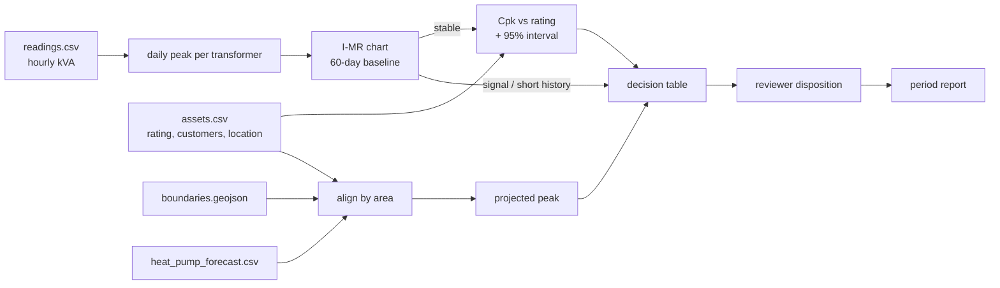

# Data codebook: Transformer Capacity Monitor

Every file the tool reads, every column, its units, how the tool uses it, and what it would take to
collect it for real. **All data in this repository is SYNTHETIC.** It is generated by
`scripts/make_synthetic_data.py` and is shaped like real utility data. None of it comes from a utility.

## 1. Files at a glance

Row counts below are for the default `normal` run of 12 labeled transformers, which `scripts/run_demo.py`
uses. The copy in `data/feeds/` may be a larger `--count` run for the map; see section 7.

| File | One row is | Rows (default 12-transformer run) | Used in step |
|---|---|---|---|
| `feeds/readings.csv` | one transformer, one hour | 20,088 (12 transformers, 2026-08-02 to 2026-10-15) | 2, then 6 to 11 |
| `feeds/assets.csv` | one transformer | 12 | 3, then 6, 7, 10, 11 |
| `feeds/boundaries.geojson` | one town, village or city polygon | 12 areas | 4, then 6, 7 |
| `feeds/heat_pump_forecast.csv` | one area and one forecast version | 24 (12 areas × 2 versions) | 5, then 6, 7, 10 |

Outputs, not inputs: `reports/<period end>/report.{html,md,json}` and the run log in
`capacity_monitor.sqlite3`. Both are git-ignored and rebuilt by each run.



## 2. `feeds/readings.csv`: transformer load readings

| Column | Type and units | Meaning | Rules the tool applies |
|---|---|---|---|
| `transformer_id` | text, e.g. `T-DRY-004` | the transformer the reading belongs to | Must match an id in `assets.csv`. Unknown ids are reported as a warning. |
| `timestamp` | ISO 8601 with UTC offset, e.g. `2026-08-02T18:00:00-04:00` | start of the hourly interval, local time | Readings outside the 60-day history window plus the 7-day period are ignored. The calendar date of the timestamp defines the day. |
| `load` | decimal, kVA | average apparent power over the hour | Must be a finite number. Bad rows are listed as problems. |
| `unit` | text, `kVA` (or `kW`) | unit of `load` | Must equal the rating unit in `assets.csv`, or the run stops at step 7. |

**Derived value used by the statistics:** the *daily peak*, which is the largest hourly `load` for a
transformer on one calendar date. Every period day must have at least one reading, or the run stops at step 7.

**How to collect it for real.** A utility gets this from its advanced metering infrastructure (AMI).
Each smart meter records interval energy in kWh, usually every 15 or 60 minutes. The connectivity model
in GIS says which meters sit under which service transformer. Summing the meters per hour gives the
transformer's kW. Dividing by an assumed power factor, or using metered kVARh, gives kVA. A utility
without AMI coverage can use a transformer load monitor or a clamp-on logger for a few weeks. The data
team exports this as a CSV or database view.

**Synthetic generation.** Each transformer gets one daily peak per day drawn from a normal distribution
with the mean and standard deviation in section 6, scaled by its rating. Each hour is that peak times a
fixed 24-hour residential load shape. The peak always falls at 18:00. Seed 7.

## 3. `feeds/assets.csv`: transformer asset records

| Column | Type and units | Meaning | Rules the tool applies |
|---|---|---|---|
| `transformer_id` | text | unique transformer id | Key for every join. |
| `name` | text | street or site name shown to the reviewer | Screened for instruction-like text. |
| `lat`, `lon` | decimal degrees, WGS 84 | transformer location | Required, or the run stops at step 7. Used to place the transformer in a boundary area and on the map. |
| `rated_max` | decimal, kVA | nameplate rating, the upper capacity limit | Required and greater than 0, or the run stops at step 7. It is the upper limit in Cpk and the denominator of every "% of rating". It never sets control limits. |
| `unit` | text, `kVA` or `kW` | unit of `rated_max` | Must match the readings unit. Also selects the forecast conversion: kW is divided by the power factor only for kVA assets. |
| `customers` | integer, count | service points (meters) fed by this transformer | Multiplies the heat-pump adoption share in step 10. If blank, no projection is made and the case goes to review. |
| `area_id` | text, e.g. `DRY` | declared primary planning area | Must match a boundary `area_id`. Used when the location falls in zero or several areas, and the reviewer sees a flag. |
| `effective_from`, `effective_to` | ISO date, `YYYY-MM-DD`; `effective_to` may be blank | dates the record is valid | A record counts only if it covers the period end date. This handles replaced transformers. |
| `notes` | text | free-text remark | Screened. Instruction-like text is quarantined and shown as a warning, never acted on. |

**How to collect it for real.** The nameplate rating, location and in-service dates come from the
utility's asset register or work-management system, joined to GIS. The customer count is a standard GIS
connectivity query that counts active service points whose meters are connected to the transformer. It
is the same data the utility uses for outage management, so a planning engineer can get it without
measuring anything.

## 4. `feeds/boundaries.geojson`: planning areas

GeoJSON FeatureCollection in lon/lat (EPSG:4326).

| Field | Type | Meaning | Rules the tool applies |
|---|---|---|---|
| `metadata.approved_version` | text | version label of the boundary set | Shown in the report. |
| `metadata.valid_from`, `metadata.valid_to` | ISO dates | period this boundary set is approved for | Must cover the period end date, or the run stops at step 7. The `boundary-mismatch` demo tests this. |
| `metadata.source` | text | where the shapes came from | Shown in the report. |
| `properties.area_id` | text | area key, matches `assets.area_id` and the forecast | Join key. |
| `properties.name` | text | e.g. "Town of Dryden" | Display only. |
| `properties.kind` | text, `city`, `town` or `village` | municipal type | Display only. |
| `geometry` | Polygon or MultiPolygon | area outline | Point-in-polygon test places each transformer. Other geometry types are rejected. |

**How to collect it for real.** Tompkins County publishes municipal boundaries through its GIS open data
portal. Export them as GeoJSON in EPSG:4326 and record the approval dates in `metadata`.
**Synthetic:** 12 rectangles around approximate town and village centres. Newfield deliberately
overlaps Enfield and Danby so the overlap warning appears.

## 5. `feeds/heat_pump_forecast.csv`: demand-growth forecast

| Column | Type and units | Meaning | Rules the tool applies |
|---|---|---|---|
| `forecast_version` | text, e.g. `TC-HP-2026-v1` | forecast release | Only rows equal to `forecast.version` in `rules/playbook.json` are used. If that version is missing, the run stops at step 7. The superseded `TC-HP-2025-v2` rows are deliberately ignored. |
| `area_id` | text | planning area | Joins to the transformer's area. |
| `horizon_label` | text, e.g. `2030 winter peak` | the future peak the forecast describes | Shown with the projection. |
| `households` | integer | households in the area | **Loaded but not used in any calculation.** It is kept for context and is a candidate for removal. |
| `hp_share_base` | decimal, 0 to 1 | share of customers with a heat pump today | The projection uses the difference between the forecast share and this share. |
| `hp_share_forecast` | decimal, 0 to 1 | share expected at the horizon | Same as above. |
| `kw_per_heat_pump` | decimal, kW | coincident winter-peak demand added per heat pump | Converted to kVA by dividing by `forecast.power_factor` (0.95) for kVA-rated assets. |
| `valid_from`, `valid_to` | ISO dates | release validity | Recorded. Not enforced; the version match is the check. |
| `notes` | text | remark | Screened. |

**Projection formula (step 10):**
`projected_peak = period_peak + customers × (hp_share_forecast − hp_share_base) × kw_per_heat_pump / power_factor`

Worked example from the `normal` demo, T-CAR-006: 60 customers × (0.57 − 0.12) × 2.4 kW / 0.95 = 68.2 kVA
added. With a 70.5 kVA period peak, the projected peak is 138.7 kVA, which is 139% of its 100 kVA rating.

**How to collect it for real.** Distribution utilities produce electrification forecasts for their
long-term load forecast and capital plan. In New York, these draw on state electrification scenarios.
The planning team already holds the area-level adoption shares. The base share comes from heat-pump
rebate and installation records. The kW per heat pump comes from utility load research or the
design-temperature heat load of a typical home. None of these are measured by the engineer per run.

## 6. The planted cases in the `normal` demo

All draws are per transformer, as a fraction of its rating: daily peak ~ Normal(mean, sd).
The generator re-draws each series until the real pipeline confirms the intended case.

| Transformer | Rating, kVA | Customers | Case | Mean, sd | What it demonstrates |
|---|---|---|---|---|---|
| T-ITH-001, T-ITH-002, T-CAY-003, T-GRO-009, T-ENF-011, T-TRU-012 | 167, 100, 100, 100, 75, 100 | 70, 40, 45, 50, 28, 48 | within | 0.60, 0.04 | stable, high Cpk, comfortable forecast margin |
| T-NEW-008 | 50 | 20 | overlap | 0.60, 0.04 | location in more than one boundary area; declared area used and flagged |
| T-DRY-004 | 75 | 30 | signal | 0.60, 0.04, plus a spike of mean + 5.5 sd on 2026-10-13 | chart signal while still below rating; Cpk withheld |
| T-LAN-005 | 167 | 75 | uncertain | 0.70, 0.0667 | Cpk at or above 1.33 but lower 95% bound below it |
| T-DAN-010 | 50 | 22 | lowcpk | 0.80, 0.06 | Cpk below 1.33 while peaks stay under the rating |
| T-CAR-006 | 100 | 60 | forecast | 0.65, 0.04, area adoption 0.57 | healthy today, forecast peak above rating |
| T-ULY-007 | 75 | 25 | insufficient | 0.55, 0.04, 12 days only | new transformer, not enough history for a chart |

## 7. Regenerating the data

```bash
.venv/bin/python scripts/make_synthetic_data.py --end 2026-10-15                               # normal
.venv/bin/python scripts/make_synthetic_data.py --end 2026-10-15 --scenario boundary-mismatch
.venv/bin/python scripts/make_synthetic_data.py --end 2026-10-15 --scenario missing-rating
```

Each command overwrites `data/feeds/`. To run a scenario without touching `data/feeds/`, use
`scripts/run_demo.py`, which works in a temporary folder (see `demo/README.md`). A fourth scenario,
`unsafe-text`, plants an instruction-like note to test the input guard.

`--count N` adds N − 12 more generated transformers, mostly "within", for a fuller map. Their ids look
like `T-ITC-101`, with ratings from 25 to 500 kVA. The row counts and the table in section 6 describe
the default of 12.
